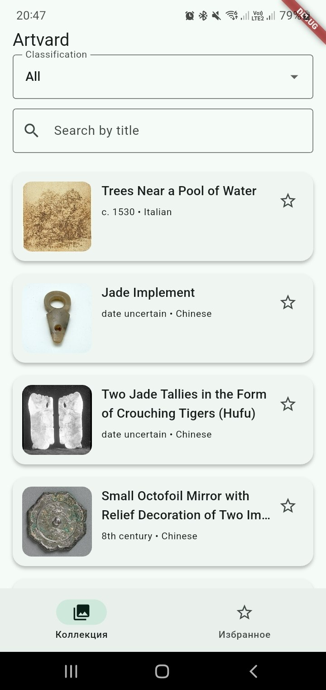

# Artvard

**Artvard** is a mobile application for exploring the collection of the Harvard Art Museums.

The application provides access to museum objects through the official Harvard Art Museums API, allowing users to browse artworks, search the collection, apply filters, view detailed information, and save favorites.

## Features

- **Artwork catalog** — browse objects from the Harvard Art Museums collection.
- **Classification filters** — narrow down the collection by object classification.
- **Search** — find artworks by title with input debouncing.
- **Infinite scrolling** — load additional objects as the user browses the collection.
- **Pull-to-refresh** — refresh the current collection.
- **Object details** — view images, artists, dates, culture, medium, and descriptions.
- **Favorites** — save and remove artworks from a personal favorites list.
- **Local persistence** — keep favorites saved between application sessions.
- **Image caching** — cache artwork images and use fallback image sources when necessary.
- **External links** — open an artwork's page on the Harvard Art Museums website.

## Screenshots

### Collection and search



### Artwork details


### Favorites


## Tech Stack

- **Flutter** — cross-platform UI framework.
- **Dart** — application programming language.
- **Harvard Art Museums API** — museum collection data.
- **Riverpod** — application state management.
- `http` — HTTP requests.
- `cached_network_image` — image caching.
- `shared_preferences` — local favorites storage.
- `url_launcher` — opening external links.
- `intl` — date and text formatting.

## Getting Started

Make sure Flutter is installed and configured.

Clone the repository:

```bash
git clone <repository-url>
cd Artvard
```

Install dependencies:

```bash
flutter pub get
```

Configure the Harvard Art Museums API key:

1. Register for an API key at [Harvard Art Museums API](https://www.harvardartmuseums.org/collections/api).
2. Replace `YOUR_HARVARD_API_KEY_HERE` in `lib/services/harvard_api.dart` with your own key.

Run the application:

```bash
flutter run
```

## Project Status

A completed individual educational project developed as part of coursework.

The application was designed and implemented independently, including its interface, API integration, state management, search, filtering, and local favorites functionality.